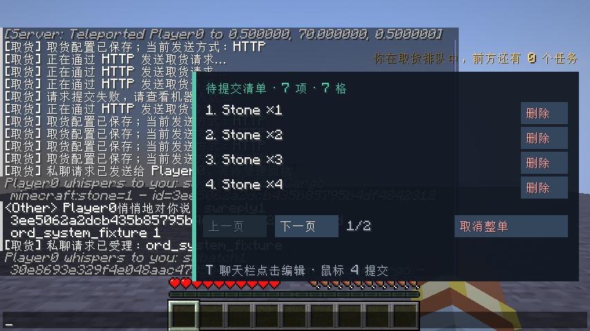
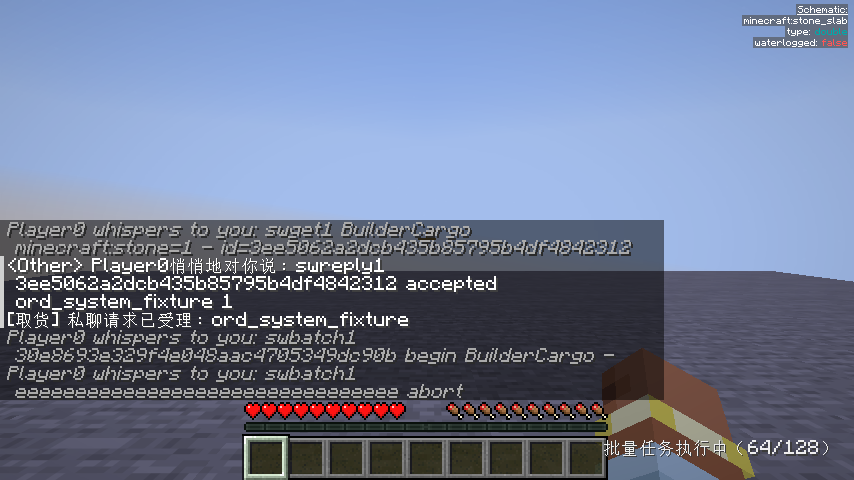
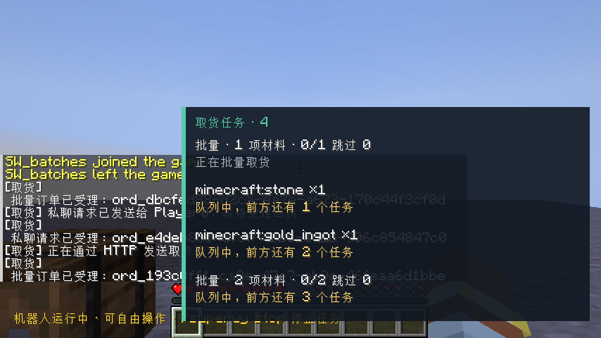
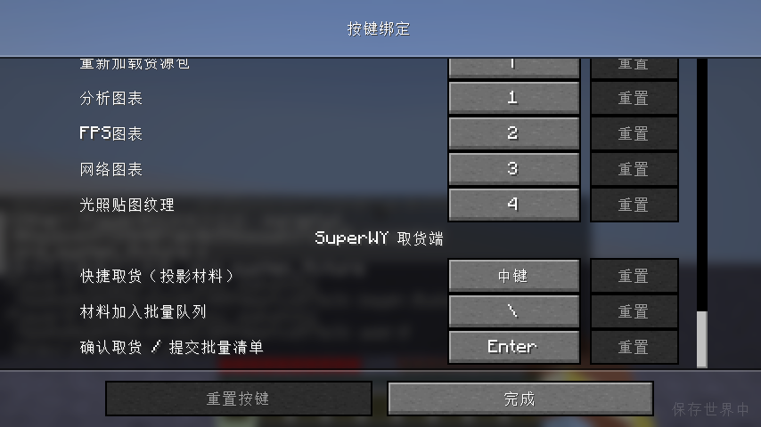
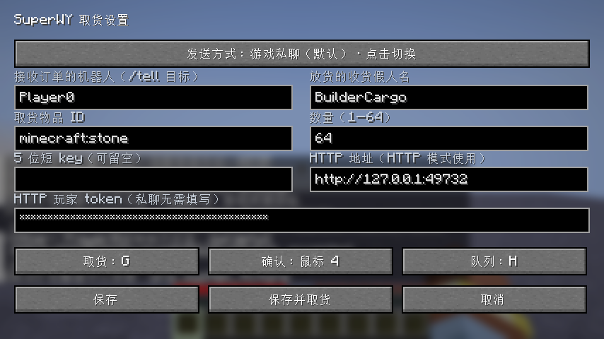
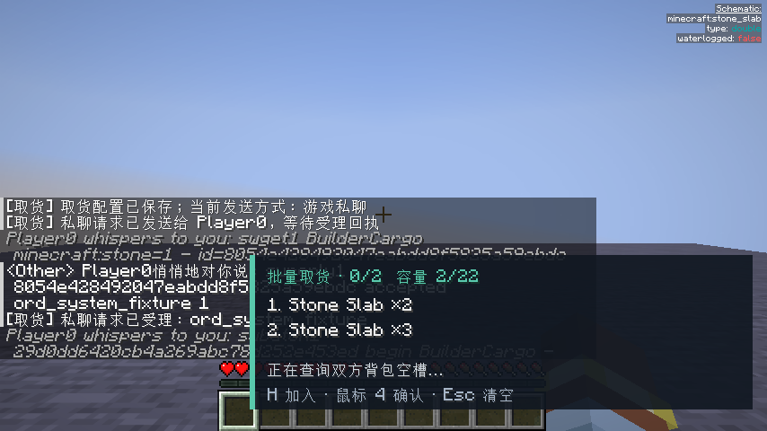
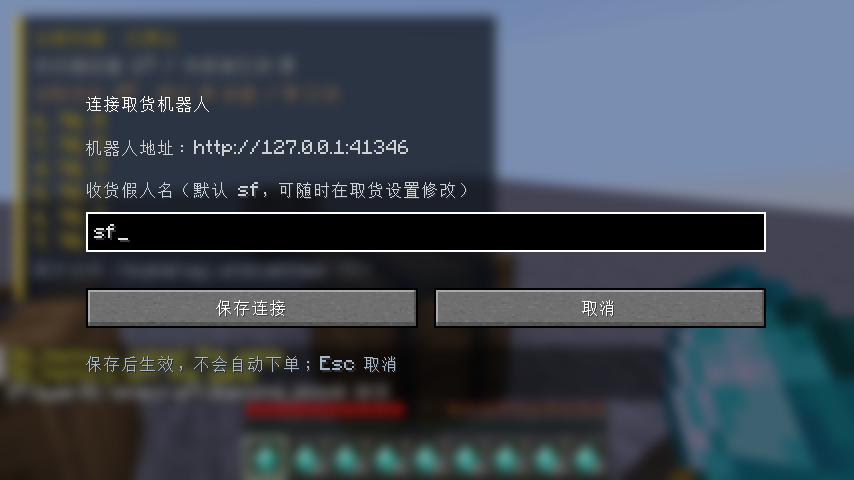
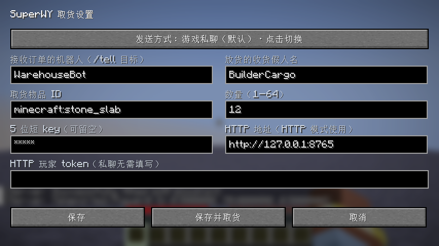

# SuperWY Requester 0.6.2

完整的玩家使用说明（全部功能、按键和指令）见 [玩家取货端使用手册](../玩家取货端使用手册.md)，发布包里同名文件。

## 结束时的缺货汇总（0.6.2，需要机器人 0.6.2）

任务遇到缺货会继续做完。任务结束后，取货端在聊天栏显示一次汇总（物品用游戏内名称）：完全缺货的物品和数量、数量不足的物品缺多少（已交付多少）、因其他原因未取到的物品。全部取齐时不显示。

## 开始前查库存（0.6.1，需要机器人 0.6.1）

- **投影取货**：在第二步（预估装箱）界面，会先向机器人查询缓存里的库存，这时按钮显示“强制开始（不等库存结果）”，可以不等直接开始。
  - 结果回来后，缺货的材料单独列在右侧一栏（需要/库存），顶部提示库存充足还是不足几种。
  - 确认后才开始取货，缺货项由机器人跳过，其余照常取货。
- **快捷键批量清单**：第一次按确认键先查库存，查询期间再按一次会强制开始；结果回来后缺货行标红并写明缺多少，再按确认键才开始。修改清单后需要重新查询。
- 超级调度模式下，库存由调度机器人回答。

## 只走 HTTP 与超级调度模式（0.6.0，需要机器人 0.6.0）

- **私聊下单已停用**：单项取货、批量清单、投影取货都通过 HTTP 提交，需要先在游戏中执行机器人主人给的 `/swrequest connect ...` 连接指令。批量清单整单一次提交；进度、排队位置每 3 秒查询一次。`/swrequest mode`、`bot`、`key` 命令已删除，旧配置自动切换为 HTTP。
- **超级调度模式**：机器人开启超级调度后，取货端必须执行 `/swrequest mesh on`（或在 `/swrequest config` 窗口点击“超级调度模式”）才能下单，任务自动发给调度机器人（默认 tiantian996），连接哪台机器人都可以。多台机器人同时执行时右下角显示 `超级调度：N 台机器人执行中（已取 x/y 件）`，排队时显示 `你在取货排队中，前方还有 N 个任务`。`/swrequest mesh off` 关闭。

## 圈投影取货（0.5.0，需要机器人 0.5.6）

用 Litematica 圈选一片区域，按投影设置键（默认 M）进入区域编辑器，右上角新增 **机器人取货** 按钮：

1. **材料清单**：统计选区内投影（原理图世界）需要的全部材料，按 Litematica 的方块→物品规则换算（如双层台阶算 2 个）。同时检查玩家背包（主背包、快捷栏、副手，以及其中潜影盒里的物品），逐项显示“需要 / 背包 / 缺少”。默认扣除已经正确放置的方块，可切换“已放置方块：扣除/不扣除”；默认只取缺少的数量，可切换“全部数量”。点击某一行可排除该材料。重叠的子区域只计一次；未加载的区块会提示无法判断是否已放置。
2. 点 **确认清单 → 预估装箱**，本地生成预估交付结果：需要几个潜影盒、每盒装什么。材料按名称归类排序后依次装盒，鼠标移到盒子上显示该盒 9×3 格的实际排布和物品汇总。清单中的潜影盒物品不能装盒，标为散装交付。同时预估收货假人：每个空假人可收 36 盒，装不下沿用 `收货名_1`、`收货名_2`。
3. 点 **下发任务**：清单按预览顺序通过私聊批量协议发给机器人（带 `parcels` 标记），机器人以多个潜影盒交付。右下角显示“投影取货执行中（已取/总件数 · 携带 N 盒）”。

**材料来源切换**：材料清单左下角“来源：投影 / 已建建筑”。“投影”统计 Litematica 投影里的方块；“已建建筑”统计选区内服务器里实际已有的方块（适合直接圈选别人建好的建筑来备料，未加载的区块不统计并会提示）。打开时自动判断：选区和已启用的投影放置重叠用“投影”，否则用“已建建筑”，判断不对时点一下切换。“已建建筑”下“已放置方块”开关不可用。

**手动改数量**：在材料行上 **右键** 打开数量窗，可输入 `128`、`2组`、`2组+5`（按该物品堆叠数计算），0 表示不取；“恢复自动”回到按需要/缺少计算。手动数量在“取货”列以黄色 `*` 标出，切换来源或扣除开关重新统计后仍保留。左键仍是排除/加入。

限制与说明：单单最多 128 种、合计 100 万件，超过请缩小选区或排除部分材料。预估假设所有材料有货、收货假人为空；缺货、假人已有物品或机器人配置了不同的携盒上限时，实际结果会不同。下发使用同服私聊，需要配置机器人名和收货假人名（`/swrequest config`），HTTP 模式同样走私聊。Litematica 仍是可选依赖：未安装时不加按钮，其他功能照常。

## 内存与连接管理（0.4.2）

HTTP 响应最多 256 KiB，并设置覆盖响应体传输的 10 秒截止时间；最多同时执行 32 个请求。断线取消未完成请求，关闭客户端立即终止网络任务与截止时间线程，避免慢响应长期占用连接和内存。任务跟踪总量最多 128 个，达到上限后提示等待，终态任务仍在 15 秒后移除。

## 草稿编辑与单行取货状态（0.4.1）

取货端不再等待背包空闲/容量判定；容量回执为 0 或较小值也不会清空或限制草稿。保留每单最多 128 项、合计 100 万件。搭配当前机器人 0.5.0/0.5.1 的自动打包与分批交付。

批量清单未提交时，按 **T** 打开原版聊天栏，鼠标点击每行右侧“删除”移除该项；“上一页 / 下一页”可访问全部材料；点击“取消整单”放弃整个草稿并通知机器人撤销。删除后重新计算总数量，其他材料顺序保留。关闭聊天栏后按原确认键提交；聊天栏内输入和 Enter 保留原版聊天行为。

提交后右下角仅保留一行文字，不再显示任务弹窗或材料列表。执行批量显示 `批量任务执行中（已取/总共）`（普通批量为材料项数；收到装盒件数回报后为件数）；等待时显示 `你在取货排队中，前方还有 xx 个任务`。多张任务优先显示正在执行的任务，否则显示最近将执行的一张。未提交草稿仍显示编辑清单。





## 大清单自动打包（搭配机器人 0.5.0）

批量清单最多 128 行、合计 100 万件，不再用机器人与假人空槽减 5 限制整单。先按队列键开始清单，再按取货键打开数量窗，可输入 1–1000000；普通单项数量仍为 1–64。右下角额外显示已取件数、请求件数和当前携带盒数。

清单超过 25 格时机器人自动领取空盒并通过 QuickShulker 打包，首轮最多 25 格、后续最多 24 格，实际不足时减少以预留工作槽。默认携带 25 盒即交付后继续，收货假人满时依次使用 `_1`、`_2`。空盒补充点默认 `129,53,-21`，64 堆叠空盒只取 1 个。网页“仓库区域”可调整坐标与上限。

任务结束后机器人将主背包 27 格余物投至全物品入口（默认 `100,49,0`），保留快捷栏、装备、副手。打包任务执行上限默认 24 小时；普通任务仍为 500 秒。需要同时更新两端。

独立的 Minecraft 26.1.2 Fabric 玩家取货端，Java 25。需要 Fabric API 和 Loader，依赖声明不限制这两项版本。默认通过同服游戏私聊下单，可在游戏内切换 HTTP；不需要在玩家端安装 Baritone、Carpet 或 QuickShulker。


## 单项与批量任务混合排队（机器人 0.4.19 / 收货端 0.3.7）

机器人正在批量取货时，可继续提交单项、批量及 HTTP/Web 任务。所有任务按机器人成功受理的顺序共用同一条 FIFO 队列，当前任务继续执行。每个凭据仍最多 5 个未结束任务，全局上限 100 个；编辑草稿本身不占任务队列，确认提交成功后才排队。

0.4.1 提交后右下角以单行显示当前执行或排队状态，例如 `你在取货排队中，前方还有 3 个任务`。前方数量包含正在执行的一张任务；前面的任务完成、取消或失败后自动更新。私聊单项和批量通过机器人私聊回传队列变化（约每秒检测一次，只发送变化），HTTP 单项按原凭据每 3 秒查询自己的订单。同一玩家可以继续编辑新批量，旧任务的队列和取货进度分别保留，完成提示停留约 15 秒。

0.4.0 起，草稿直接返回最多 128 行的清单上限，超背包材料由打包与分批交付处理。等待中的草稿不召唤或移除收货假人，不暂停当前取货；仍保留逐项异常跳过和原版按键设置。

两端都需更新至上述版本。自用机器人 jar 保留原有 FRP 预设。



## 原版按键绑定入口（0.3.6）

打开游戏 **选项 → 控制 → 按键绑定**，向下滚动到 **SuperWY 取货端** 分类，可直接修改三个按键：快捷取货（默认鼠标中键）、确认取货 / 提交批量清单（默认 Enter）、材料加入批量队列（默认 `\ |`）。支持鼠标侧键、Esc 取消绑定和恢复默认；与 `/swrequest config` 中的三个绑定双向同步。改键后立即生效，并写入原版 options.txt 与取货配置。

首次从旧收货端升级会保留原来设置的三个快捷键；之后原版保存的按键设置参与启动恢复。原版页面中的重复键采用游戏原有冲突提示，取货设置页面仍要求三个非空绑定互不重复。界面内改键不会发出取货请求。

替换旧收货端 jar 后重启游戏；机器人需使用 0.4.19 才支持批量期间继续排队。批量功能和收货端 0.3.5 的行为保留。



## 批量异常跳过与部分交付（机器人 0.4.18 / 收货端 0.3.5）

批量清单按行处理。缺货（包括只取到部分数量）、来源或源盒变化、容器界面关闭/切换、开箱超时等项目异常会显示 `物品ID 取货错误：原因；已跳过，继续下一项`，记录该行的 `skipped`、`errorCode` 和未取数量 `shortfall`，然后继续下一项。已经核实取到的材料保留，处理完全部项目后统一召唤快递假人、存放并下线；部分交付为 `partial_stored_offline`，公屏仍发送 `搞定了，我歇逼了`。全部无货时不召唤空快递，收货端显示“清单已处理完，均未取得材料”。普通单项订单保持原有失败行为。

右下角进度改为“已处理 / 总项数”，跳过的项目计入已处理数，同时显示跳过数量和 `[跳过]` 标记；完成时区分完整交付、部分交付及全部未取到材料。需要双方同时更新以识别新增跳过消息和结束状态。

“容器界面已变化”（MENU_DESYNC）指点击前保存的界面 ID 与当前界面 ID 不一致，不表示箱子内容必然变化。界面被关闭、切换或服务端重开界面均可触发；仅凭提示无法判断具体诱因。点击中途发生变化时先关闭空光标界面，通过服务端实体 NBT 核对取物前后的背包，核实已取数量，归还借出的源盒并刷新来源缓存，再继续下一项，避免同箱后续材料被错误视为缺货。光标仍有残留、背包变化无法核实、源盒无法安全归还、取消/断线/超时或交付不确定时仍停止并保留货物待核对，不自动重新取一份。

## 批量取货与自定义快捷键（机器人 0.4.17 / 收货端 0.3.4）

收货端 `/swrequest config` 新增“取货 / 确认 / 队列”三个按键按钮。点击按钮后按键盘键或鼠标键完成绑定，Esc 取消绑定；三个键不能重复，保存后重启保留。默认：鼠标中键取货、Enter 确认、`\ |`（Enter 上方）加入队列。主 Enter 默认也兼容小键盘 Enter。

对准投影按队列键将默认数量加入清单；已有草稿后按取货键打开数量窗，可输入 1–1000000，再按队列键加入。首次加入通过 `/tell` 获取最多 128 行的清单上限，不召唤收货假人；合计最多 100 万件，超背包清单自动打包。

选好材料后按确认键统一提交，数量窗关闭时依然有效；若仍打开，当前材料一并入队。没有数量窗时按 Esc 放弃草稿；编辑约两分钟超时。右下角显示已处理行数（含跳过项）、打包已取件数和携盒数。达到携盒上限即交付并继续，全部处理后交付剩余材料，成功后公屏发送 `搞定了，我歇逼了`。

草稿编辑和批量执行期间允许新任务入队，按上文统一 FIFO 处理。清单采用有序短私聊分包发送，不受单条清单长度限制，每张清单只生成一个任务；请求失败不自动重发。

批量功能在 HTTP 设置下也使用同服私聊，需要填写机器人名并开启机器人私聊接单；普通单项取货继续使用原发送方式。双方必须更新到上述版本，旧版仍可进行普通单项取货。






## 安装与配置



机器人端 **0.4.8** 可用 `/superwy connect` 或网页“连接与接口”生成一条 `/swrequest connect swc2.…`，机器人端不用填写收货名。玩家在游戏中粘贴执行后弹窗输入收货假人名，默认 `sf`，可自行修改。点击“保存连接”后才持久保存 HTTP 地址、普通玩家凭证和收货名，并切换 HTTP；取消/Esc 或无效名称保留原配置。原有物品/数量偏好保留，不自动下单。

之后可在 `/swrequest config` 中更改收货名或 HTTP 配置，或执行 `/swrequest recipient MyCargo`；再次粘贴新连接指令可以重新配置连接。`/swrequest connect` 无参数也会打开设置。新凭证支持修改收货名，订单查询/取消仍仅限自己的订单，不具备管理员权限。旧 `swc1` 仍兼容，但旧凭证受原收货名限制，建议向机器人取得新指令。连接内容只在本地处理，不向游戏服务器发送。公网端口成功注册后会由机器人持久记忆，正常重启无需重新导入；冲突换号后才需要新指令。

1. 将 `dist/superwy-requester-0.4.1.jar` 放入玩家游戏实例的 mods；新版指令连接功能搭配机器人端 0.4.8。
2. 游戏中输入 `/swrequest` 或 `/swrequest config` 打开设置窗口。
3. 填写接收订单的机器人玩家名（即 `/tell` 目标），以及放货的收货假人名。二者是不同用途的名称。
4. 默认选择游戏私聊。可选短 key 留空即不发送验证；若机器人启用了验证，填写匹配的 5 位字母数字，区分大小写。
5. 可直接配置物品 ID 和数量 1–64，点“保存并取货”；或者保存设置后使用投影中键下单。
6. 点击发送方式按钮切换 HTTP 时，额外填写机器人 HTTP 地址及原有玩家 token。5 位短 key 不代替 HTTP token。

窗口中的短 key 和 HTTP token 使用掩码显示。设置立即写入本机 `config/superwy-requester/config.json`，下次启动保留；不需要手动编辑文件。设置窗口允许正常编辑文字；投影数量窗仍是不会影响移动的 HUD。



## 命令

```
/swrequest config
/swrequest connect
/swrequest bot WarehouseBot
/swrequest recipient MyCargo
/swrequest key off
/swrequest item minecraft:stone
/swrequest count 64
/swrequest mode chat
/swrequest send
/swrequest request minecraft:iron_ingot 12
/swrequest mode http
/swrequest reload
```

`key Ab123` 设置短 key，`key off` 清空。模式只有 `chat` 和 `http`。机器人端默认允许无 key 私聊，也可由管理员用 `/superwy whisper key Ab123` 开启验证。

## 投影取货

中键投影功能额外安装 Litematica 0.27.14 和 MaLiLib 0.28.12（对应 26.1.2）。只使用手工配置取货时不需要这两个 Mod。

对准已加载并显示的 Litematica 投影按中键，读取实际材料物品，浮窗数量使用配置默认值（默认 64）。输入 1–64 后 Enter 按所选方式发送，Esc 关闭；Backspace、Ctrl+A 均可用。窗口不打开 Screen、不解锁鼠标，保留移动、跳跃、视角和普通交互；实际连续移动 1 秒自动关闭，旋转视角不关闭，失焦或打开其他界面也会关闭。未命中投影时保留原中键行为。

## 私聊与 HTTP 行为

私聊使用 `/tell`，双方需在同一服务器。0.3.1 同时识别服务器改用系统包发送的中文/英文私聊回执；机器人端也需更新到 0.4.1。消息已发送不等于订单受理：机器人返回匹配请求 ID 的受理回执后，玩家端才显示“私聊请求已受理”。约 15 秒无回执提示未确认，不自动重发。每次主动提交独立生成新 ID，普通单项请求互相独立；新的批量草稿和 HUD 见上文。

HTTP 模式继续使用 `POST /api/v1/orders`、Bearer token 和每请求独立幂等键。HTTP 错误或仍在处理的旧请求不阻止继续提交。此前的公网设置、HTTP 地址和玩家凭据仍可使用。

`/swrequest status` 在私聊模式显示本次会话最近受理的订单 ID；实际交付与取消请查看机器人 Web 管理页面。HTTP 模式的 `/swrequest status [订单ID]` 与 `/swrequest cancel <订单ID>` 仍直接查询/取消该 HTTP 凭据自己的订单。游戏 UUID 与 HTTP 凭据是不同身份，不使用短 key 访问 HTTP。

机器人端继续负责多人 FIFO、背包不溢出、原地召唤指定假人并将材料放入 GCA 背包，以及核对后下线保存。执行期间可立即取消，单单执行上限 500 秒。受理回执不代表已交付。

协议与手工清单示例见 [私聊协议](PRIVATE_MESSAGES.md)。

## 构建

```powershell
$env:JAVA_HOME='C:\Program Files\Java\jdk-25.0.2'
.\gradlew.bat test build
.\gradlew.bat runClientGameTest
```

测试环境为 Fabric Loader 0.19.5、Fabric API 0.155.3+26.1.2。源码工作区共用 `../shared/src/main/java`，独立源码归档包含 `shared-src/`，可单独构建。真实客户端测试依赖放入 test-libs，不进入发布包。验证记录见 VERIFICATION.md。
